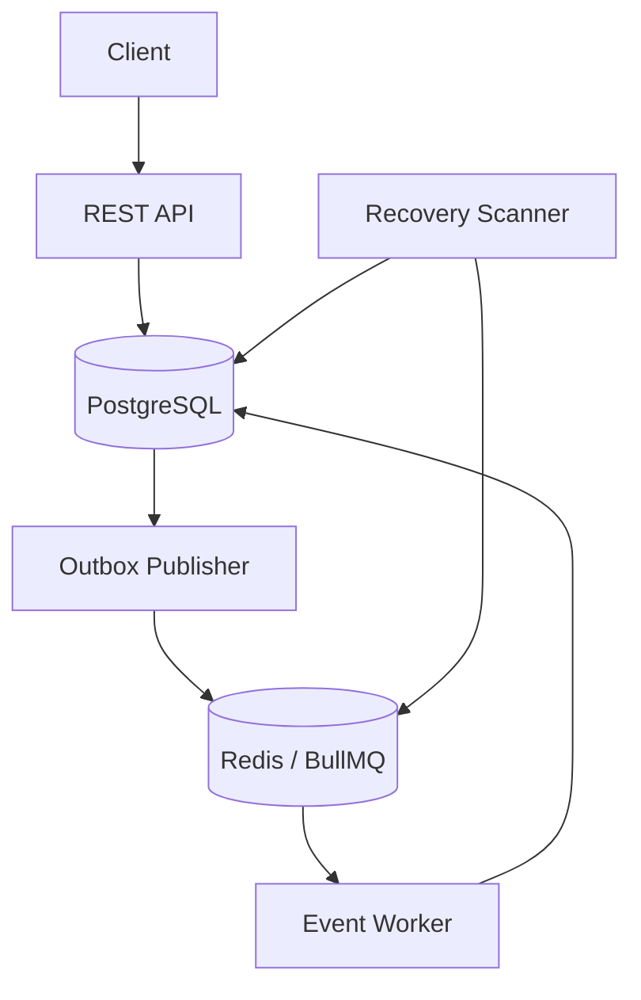

# Tessera — Event-Driven Backend System

A fault-tolerant, asynchronous event-processing backend built with **Node.js, TypeScript, PostgreSQL, Redis, BullMQ, and Docker**.

Tessera demonstrates reliable event ingestion, transactional event publishing, background job processing, retry mechanisms, and recovery from interrupted processing.

## Overview

In distributed backend systems, processing an event reliably is challenging. Events can be duplicated, workers can fail, and messages can remain unprocessed when services restart.

Tessera addresses these challenges through an event-driven architecture that combines PostgreSQL transactions, the Transactional Outbox Pattern, Redis-backed job queues, and independent background workers.

The system accepts events through a REST API, persists them transactionally, publishes them to a job queue, and processes them asynchronously while tracking their lifecycle.

## Architecture



### Core Components

| Component | Responsibility |
|---|---|
| REST API | Accepts and validates incoming events |
| PostgreSQL | Stores events and transactional outbox records |
| Outbox Publisher | Publishes pending outbox events to BullMQ |
| Redis | Provides queue infrastructure |
| Event Worker | Processes queued events asynchronously |
| Recovery Scanner | Detects stale processing events and requeues them |

The application runs as independent services using Docker Compose.

## Event Processing Workflow

1. **Event ingestion:** The client submits an event through the REST API.
2. **Validation and persistence:** The API validates the event and uses a PostgreSQL transaction to persist the event and its corresponding outbox record atomically.
3. **Outbox publishing:** The publisher identifies pending outbox records and submits corresponding jobs to BullMQ.
4. **Asynchronous processing:** The worker consumes queued jobs and updates event lifecycle states.
5. **Retry handling:** Failed jobs can be retried using exponential backoff.
6. **Recovery:** The recovery scanner identifies stale events left in processing states and requeues them for processing.

## Key Features

- **Idempotent Event Ingestion:** Handles duplicate event submissions to avoid creating duplicate event records.
- **Transactional Outbox Pattern:** Atomically persists business events and outbox records to prevent event loss between database writes and queue publishing.
- **Asynchronous Processing:** Uses Redis and BullMQ to decouple event ingestion from background execution.
- **Retry Mechanism:** Supports automatic retries with exponential backoff for failed jobs.
- **Event Lifecycle Tracking:** Tracks event states such as `RECEIVED`, `PROCESSING`, `COMPLETED`, and `FAILED`.
- **Stale Event Recovery:** Detects interrupted processing and requeues eligible events.
- **Containerized Architecture:** Runs the API, workers, PostgreSQL, and Redis as independent Docker Compose services.

## Technology Stack

| Category | Technologies |
|---|---|
| Runtime | Node.js |
| Language | TypeScript |
| API | Express.js, REST |
| Database | PostgreSQL |
| Queue | BullMQ |
| Cache / Queue Infrastructure | Redis |
| Containerization | Docker, Docker Compose |

## API Endpoints

### Health Check

`GET /health`

Checks whether the API service is running.

Example response:

```json
{
  "status": "ok",
  "service": "tessera"
}
```

### Ingest Event

`POST /events`

Submits an event for asynchronous processing.

Example request:

```json
{
  "eventId": "evt_001",
  "type": "OrderPlaced",
  "payload": {
    "orderId": "order_123",
    "amount": 2000
  }
}
```

The API validates the request, persists the event and outbox record transactionally, and returns the ingestion result.

## Running Locally with Docker

### Prerequisites

- Docker Desktop
- Git

### 1. Clone the repository

```bash
git clone <YOUR_REPOSITORY_URL>
cd tessera
```

### 2. Configure environment variables

Configure the environment variables required by the Docker Compose configuration and database connection.

### 3. Start the services

```bash
docker compose up --build
```

### 4. Verify the API

Open:

```text
http://localhost:3000/health
```

### 5. Submit a test event

Use the `POST /events` endpoint with the example request above.

### 6. Inspect service logs

```bash
docker compose logs -f
```

### 7. Stop the services

```bash
docker compose down
```

## Engineering Concepts Demonstrated

- Event-driven architecture
- Database transactions and atomic persistence
- Transactional Outbox Pattern
- Idempotency and duplicate handling
- Asynchronous job processing
- Message queue architecture
- Retry strategies and exponential backoff
- Failure detection and recovery
- Docker containerization and service orchestration

## Project Goal

Tessera was built to explore the engineering challenges involved in reliable asynchronous backend systems, particularly how to coordinate database persistence, message publishing, background processing, and recovery across independent services.
